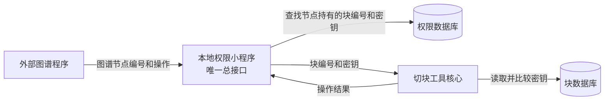

# 块所有权密钥与单一本地接口设计

## 1. 文档状态

- 状态：已实现
- 适用项目：`elixir-sqlite-chunker`
- 目标：使用稳定的随机块密钥控制读取、覆写和删除，并由外部权限小程序维护“图谱节点—块密钥”关系

## 2. 核心定义

每个块都是独立对象。块数据库保存块的稳定随机密钥，接口调用方必须同时提供块编号和密钥。只有请求密钥与数据库密钥完全一致，工具才允许读取、完整覆写或删除该块。

块内容哈希只作为存档信息，用于标识内容，不参与权限判断。所有权使用创建块时生成的随机密钥；正常覆写不会改变密钥。

图谱不存放在本工具中。一个图谱节点可以持有多个块密钥，这种对应关系由工具之外的本地权限小程序保存。

“全量覆写”只表示完整替换一个明确指定块的首行、末行和正文，不表示同步整个图谱，也不会删除请求中未出现的块。删除只能由明确的删除操作触发。

## 3. 总体结构



职责边界：

- 块数据库是权限校验的最终可信来源。
- 权限数据库保存图谱节点当前持有的块编号和随机密钥副本。
- 权限小程序负责唯一对外接口、查找密钥、调用工具以及更新密钥。
- 切块工具不保存图谱节点，不判断图谱业务关系，只验证块编号与随机密钥。

## 4. 块数据库设计

### 4.1 保留的表

保留现有 `sources` 表，用于记录导入来源。现有字段暂不删除：

| 字段 | 类型 | 说明 |
|---|---|---|
| `id` | INTEGER | 主键，自增 |
| `path` | TEXT | 源文件路径 |
| `name` | TEXT | 源文件名 |
| `language` | TEXT | 源文件语言 |
| `source_sha256` | TEXT | 整个源文件摘要 |
| `byte_length` | INTEGER | UTF-8 字节数 |
| `line_count` | INTEGER | 总行数 |
| `created_at` | TEXT | 创建时间 |

### 4.2 精简后的块表

从 `chunks` 表删除以下字段：

- `kind`
- `label`
- `start_byte`
- `end_byte`
- `token_estimate`

保留字段：

| 字段 | 类型 | 约束 | 说明 |
|---|---|---|---|
| `id` | INTEGER | 主键，自增 | 块编号；创建时也允许客户端指定 |
| `source_id` | INTEGER | 非空、外键 | 所属源记录 |
| `chunk_index` | INTEGER | 非空 | 同一源记录内的显示顺序 |
| `start_line` | INTEGER | 非空、正数 | 首行，包含该行 |
| `end_line` | INTEGER | 非空 | 末行，包含该行且不小于首行 |
| `text` | TEXT | 非空 | 块的完整正文 |
| `chunk_sha256` | TEXT | 非空 | 块内容摘要，仅保存，不参与权限判断 |
| `access_key` | TEXT | 非空、唯一 | 稳定的块所有权密钥 |
| `created_at` | TEXT | 非空 | 首次创建时间 |

建议增加以下约束和索引：

```sql
CHECK (start_line > 0);
CHECK (end_line >= start_line);
CREATE INDEX idx_chunks_source_id ON chunks(source_id);
CREATE INDEX idx_chunks_source_lines
    ON chunks(source_id, start_line, end_line);
```

两个块的行范围不会交叉，因为切块的时候就不会切出交叉的块

### 4.3 随机密钥与内容哈希

创建块时使用 Python `secrets.token_hex(8)` 生成密钥。结果为 16 个小写十六进制字符，来自 8 个随机字节。

- 密钥与块内容无关。
- 覆写正文或首末行时，密钥保持不变。
- 只有创建块或以后明确增加“换钥”操作时才生成新密钥。
- 创建时如果极小概率碰到唯一约束冲突，重新生成后再插入。
- 密钥不得写入普通日志、错误信息或其他图谱节点的响应。

`chunk_sha256` 继续保存正文 UTF-8 字节的 SHA-256。正文变化时同步更新该字段，但权限流程不读取、不比较该字段，也不把它交给权限小程序。

### 4.4 只按函数切块

导入 Elixir 源码时只为函数定义创建块，不为模块或普通段落创建块。

识别以下函数定义形式：

- `def`
- `defp`
- `defmacro`
- `defmacrop`
- `defguard`
- `defguardp`

切块规则：

1. 每一个函数定义对应一个独立块。
2. 同名函数的不同匹配子句分别保存为不同块，不自动合并。
3. 函数前连续且紧邻的注释、`@doc`、`@spec` 和 `@impl` 归入该函数块，块的首行从这些附属内容开始。
4. 多行函数从函数定义开始，一直包含到该函数自身对应的 `end`；函数内部的 `if`、`case`、`cond`、`with`、`for`、`fn`、`receive` 和 `try` 等嵌套结构不能导致提前截断。
5. `def name(args), do: expression` 形式的单行函数单独成为一个块，首行和末行相同；如果前面带有附属说明，首行从附属说明开始。
6. `defmodule` 只用于确定语法作用域，不生成模块块。
7. `alias`、`import`、`require`、`use`、`defstruct`、普通模块属性及其他模块级代码全部忽略，不写入块表。
8. 嵌套模块中的函数仍可切块，但只保存函数及其附属说明，不保存模块外壳。
9. 完全空白、注释后没有函数、无法解析的残余代码均不生成块。

不能通过简单正则表达式或直接统计文本中的 `do` 和 `end` 确定函数边界，因为字符串、注释、heredoc 和嵌套结构可能包含相同文本。实现时必须使用能够提供 Elixir 语法节点首末位置的解析器；解析失败时整个文件导入失败并返回明确错误，不允许退回按空行切块。

块的 `start_line` 和 `end_line` 使用从 1 开始的闭区间，分别表示该函数块在原文件中的准确首行和末行。

## 5. 权限小程序数据库

权限小程序使用独立 SQLite 文件，不把图谱所有权写入块数据库。

### 5.1 图谱节点表

| 字段 | 类型 | 约束 | 说明 |
|---|---|---|---|
| `graph_node_id` | TEXT | 主键 | 外部图谱节点编号 |
| `created_at` | TEXT | 非空 | 首次登记时间 |
| `updated_at` | TEXT | 非空 | 最近更新时间 |

### 5.2 块所有权表

| 字段 | 类型 | 约束 | 说明 |
|---|---|---|---|
| `graph_node_id` | TEXT | 外键、非空 | 持有该块的图谱节点 |
| `block_id` | INTEGER | 唯一、非空 | 块编号 |
| `block_key` | TEXT | 非空 | 图谱节点持有的稳定随机密钥 |
| `created_at` | TEXT | 非空 | 首次获得时间 |
| `updated_at` | TEXT | 非空 | 所有权记录最近更新时间 |

主键采用 `(graph_node_id, block_id)`，同时对 `block_id` 设置唯一约束，保证一个块同一时刻只归属一个图谱节点。


## 6. 唯一总接口

权限小程序只暴露一个本地业务入口：

```text
POST /api/blocks
```

默认监听 `127.0.0.1`，不上网。操作由请求中的 `operation` 区分：

- `create`：创建一个或多个新块。
- `read`：读取一个或多个已拥有的块。
- `rewrite`：完整覆写一个或多个已拥有的块。
- `delete`：删除一个或多个明确指定的完整块。

统一请求外形：

```json
{
  "operation": "rewrite",
  "graph_node_id": "graph-001",
  "blocks": [
    {
      "id": 10,
      "start_line": 20,
      "end_line": 35,
      "text": "完整的新块正文"
    }
  ]
}
```

外部图谱程序不需要直接传入块内容哈希。权限小程序根据 `graph_node_id` 和块编号从自己的数据库取得随机密钥，再把块编号和密钥交给切块工具校验。

统一响应外形：

```json
{
  "success": true,
  "error_code": null,
  "message": "ok",
  "data": {}
}
```

任何失败都返回稳定错误码，不返回数据库异常堆栈。建议至少包含：参数错误、图谱节点不存在、未拥有该块、块不存在、密钥错误、行范围冲突、并发冲突和内部错误。

## 7. 操作流程

### 7.1 创建块

1. 接收图谱节点编号、块编号（可选）、源记录、顺序、首行、末行和完整正文。
2. 校验行号、编号冲突和区间交叠。
3. 块编号为空时由 SQLite 生成；指定编号已存在时拒绝。
4. 使用 `secrets.token_hex(8)` 生成首个随机密钥，同时计算仅供存档的内容哈希。
5. 写入块数据库并返回块编号和随机密钥。
6. 权限小程序把块编号和随机密钥登记给请求中的图谱节点。

### 7.2 读取块

1. 权限小程序按图谱节点编号和块编号查找所持随机密钥。
2. 将块编号和随机密钥交给工具。
3. 工具读取 `access_key` 并使用恒定时间比较。
4. 比较正确才返回完整块；不正确则返回密钥错误。

### 7.3 覆写块

1. 权限小程序取得图谱节点当前持有的随机密钥。
2. 工具在事务内读取目标块并验证随机密钥。
3. 校验新的首末行以及与其他块的区间冲突。
4. 用请求中的首行、末行和正文完整替换目标块。
5. 更新正文和仅供存档的内容哈希，所有权密钥保持不变。
6. 更新语句同时限制块编号和随机密钥，防止无权覆写。
7. 工具提交后返回成功结果；权限小程序无需更换密钥。

覆写请求中没有出现的其他块保持原样，绝不自动删除。

### 7.4 删除块

1. 删除必须使用独立的 `delete` 操作。
2. 权限小程序取得每个目标块的随机密钥。
3. 工具逐个验证块编号和数据库随机密钥。
4. 全部验证成功后，删除请求中明确列出的完整块。
5. 权限小程序删除相应所有权记录。

编辑、覆写、创建或读取操作均不能隐式触发删除。

## 8. 多块请求与事务

一个请求可以包含多个块。工具必须先完成所有块的权限、参数和区间校验，再执行数据库修改。

- 任一块无权限和任一随机密钥错误，整个请求不失败，只操作有权限的块。
- 创建或删除完成后，权限小程序按操作结果更新自己的所有权数据库；普通覆写不更新密钥。

## 9. 浏览器和导入程序调整

- 导入程序删除按空行分段以及块分类、标题、字节偏移和令牌估算逻辑。
- 导入程序改为只提取函数定义；模块和其他模块级内容不生成块。
- 导入时为每块生成稳定随机密钥并交给权限小程序登记；内容哈希只保存在块数据库。
- 桌面浏览器删除类型、标题和令牌估算列。
- 浏览器只显示块编号、顺序、首末行和正文。
- 受保护块不得通过浏览器绕过密钥校验直接读取；浏览器应通过权限小程序读取。

## 10. 安全边界

- 接口仅监听本机，但所有块操作仍必须经过数据库随机密钥比较。
- 能访问权限小程序数据库的进程可以取得图谱节点持有的全部块密钥，因此必须限制该数据库文件的系统权限。
- `secrets.token_hex(8)` 提供 64 位随机性。本设计基于接口仅在本机使用且块数量很少的前提接受该长度。
- 日志只记录操作编号、图谱节点编号、块编号和结果，不记录随机密钥及完整正文。

## 11. 验收标准

1. 块表已删除五个无用字段，其他字段和数据得到保留。
2. 块数据库中的 `access_key` 是每次鉴权的最终依据，`chunk_sha256` 不参与权限判断。
3. 正确随机密钥允许读取、覆写和删除；错误密钥被拒绝。
4. 覆写后随机密钥保持不变，内容哈希可随正文更新。
5. 新建块使用 `secrets.token_hex(8)` 生成密钥，冲突时自动重新生成。
6. 新建块返回首个随机密钥并登记给指定图谱节点。
7. 一个图谱节点能够拥有多个块，但不能操作其他节点拥有的块。
8. 覆写未提及的块不会被删除或修改。
9. 只有明确的删除操作能够删除请求中列出的完整块。
10. 对外仅存在一个本地业务接口。
11. 权限小程序重启后能够从独立数据库恢复所有权关系和未完成操作。
